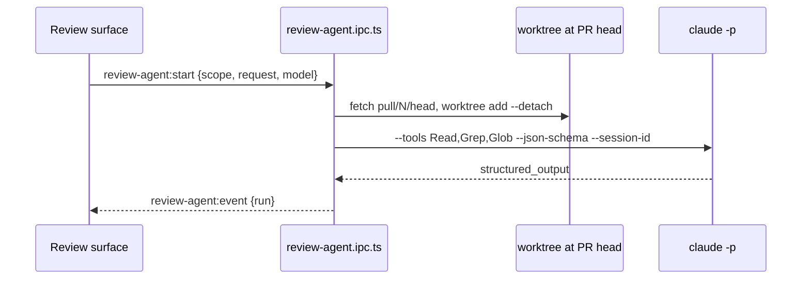

# ADR 073: The review agent reads, and never writes

**Status**: Accepted

Amended by ADR 130: the review agent now runs over ACP (`api.agents.runOnce`), not `claude -p`.

**Date**: 2026-09-27

## Context

Reviewers wanted an agent's opinion on a PR, a chapter, a file, a hunk or a few lines, kept as private context. Nothing the agent says should reach GitHub unless the reviewer posts it. ADR-026 moved supervised runs into terminals and kept the headless spawn for self-review. The runner of Foundry lives in another extension, which Principle II rules out.

## Decision

- The agent runs headless, `claude -p --output-format json --json-schema`, in a detached worktree at the PR head under `.git/terminator-review/`. The app keeps at most five worktrees.
- Its tools are `Read,Grep,Glob` and nothing else. It has no Bash and no network tool, so it cannot run `gh`. It therefore cannot post, push or change the branch.
- Zod validates the output. A run that fails validation is a failed run, never a partial list of findings. Severities are rendered into the prompt from `FINDING_SEVERITIES`.
- Runs and dismissals are stored in electron-store on this machine only. A finding reaches GitHub only through the own "Post as comment" of the reviewer, which opens the composer. The composer then adds the comment to a pending review.
- The model defaults to Sonnet. The reviewer can switch it to Opus per run. "Continue in terminal" resumes the same session with `claude --resume`.
- The environment of the child drops inherited `CLAUDE_CODE_*` variables, so a run never joins the session of the parent.

## Consequences

- A run shows its elapsed time but not its tool calls, because `-p` reports only at the end.
- Reviewing an uncloned repository needs a clone first. The diff-only view has no worktree to read.
