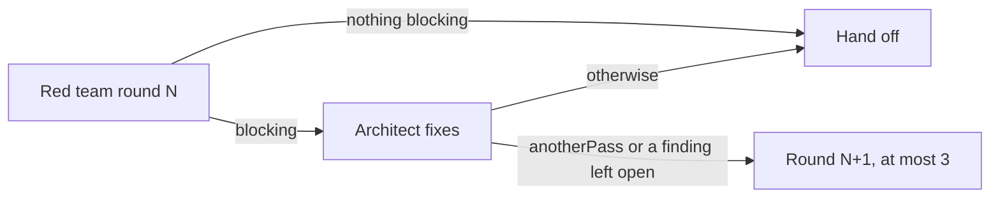

# ADR 075: One red-team pass unless the red team asks for another

**Status**: Accepted

**Date**: 2026-09-28

Amends ADR 069 (the red team argues before agreement). The loop still stops at
`MAX_REVIEW_ROUNDS` (3), but a fix is no longer reviewed by default.

## Context

On WO-0928-0bb (TAV-15) the Forge ran three red-team rounds and two architect
fix turns before hand-off. The ledger of the order shows them from 18:53:08 to
18:58:01. Every round after the first attacked a fix that answered a finding
that the red team had already stated precisely. Reviewing every fix made the
cap set the length of the loop, not what the order needed.

## Decision

- The output of the red team takes an optional `anotherPass` boolean
  (`src/line/rung-output.ts`). Only a role that writes `findings` is offered
  it. It defaults to one pass.
- A round that asks for it records `review.another_pass` in the ledger, right
  after `review.round`. `anotherPassWanted` in `src/forge/intake-outcome.ts`
  reads it back, so the decision survives a restart.
- When the fix turn of the architect lands, `afterFix` in
  `src/forge/review-loop.ts` decides. It hands off, unless the red team asked
  for another pass or the architect left a blocking finding open. Either of
  those runs the next round.
- `reviewNext` is unchanged. A third round that still finds something blocking
  goes to the operator as before.

## Consequences

- The common case is one round and one fix turn.
- A fix that nobody reviewed can reach the Line. The inspection and final
  checks of the Line still run. The red team can ask for a second look when a
  fix changes the plan materially.
- Releasing a hold still reviews a plan that the red team has not seen
  (`afterRelease`). This can add one round that the loop would have skipped.
