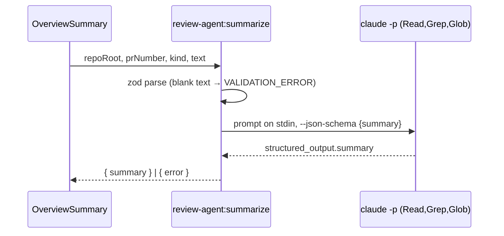

# ADR 111: PR summaries run the review agent's claude

**Status**: Accepted
Amended by ADR 130: the summary now runs over ACP (`api.agents.runOnce`), not `claude -p`.
**Date**: 2026-10-14
**Relates to**: [ADR 073](073-the-review-agent-reads-and-never-writes.md), [ADR 091](091-sanitised-html-in-pr-comments.md), [ADR 096](096-every-ipc-channel-has-a-schema.md)

## Context

The Description and Discussion tabs of the PR overview offer **Summarize**: a few sentences on a long description or thread. Something must turn that text into a summary. The git-integration extension already starts one model process, the `claude -p` of the review agent (ADR 073). It runs read-only, inside a scrubbed environment. The extension cancels it when the extension stops.

## Decision

**A summary is one `review-agent:summarize` call. The call runs the `claude` of the review agent with the same read-only tools and settings.**

- **Same runner, same tools.** `runSummary` (`extensions/git-integration/src/review/review-agent.ts`) uses the step that the review run uses to find `claude`, spawn it, time it out and cancel it. The arguments are `-p --output-format json --json-schema` (requiring `summary`) and `--tools Read,Grep,Glob`. The model, effort and timeout come from the review agent settings. A timeout message states the configured minutes.
- **Not `api.shell.exec`, not an SDK.** `shell.exec` runs git and gh inside declared roots. It does not run `claude`, and it does not cancel on dispose, which a model call needs. An Anthropic SDK dependency would add a second model path, with its own key handling and no read-only tool limit, for a feature that the existing agent already covers (Principle IV).
- **cwd is the extension's storage folder** (`api.paths.globalStorage`). `repoRoot` can be `gh:owner/name`, which has no folder, and a summary reads no checkout. So the call makes no PR worktree.
- **Nothing is persisted.** The component state of the overview holds the summary, per tab, until the overview closes or the PR changes. There is no store, no cache and no automatic run.
- **Cancelled with the extension.** The child goes into the same `liveRuns` map as the review runs, so `deactivate` kills it.
- **Local only.** The channel starts a process, so it is not in `REMOTE_READ_CHANNELS`.

## Consequences

- The PR body and comments are untrusted text that goes into a prompt. With only Read, Grep and Glob, the worst case is a misleading summary, or a summary that quotes a file under the storage folder. The prompt marks the text as content, not instructions. The app renders the summary only through `RichContent`, which sanitises it (ADR 091).
- Each Summarize press costs one model call. The app reuses nothing between presses, between tabs or between PRs.
