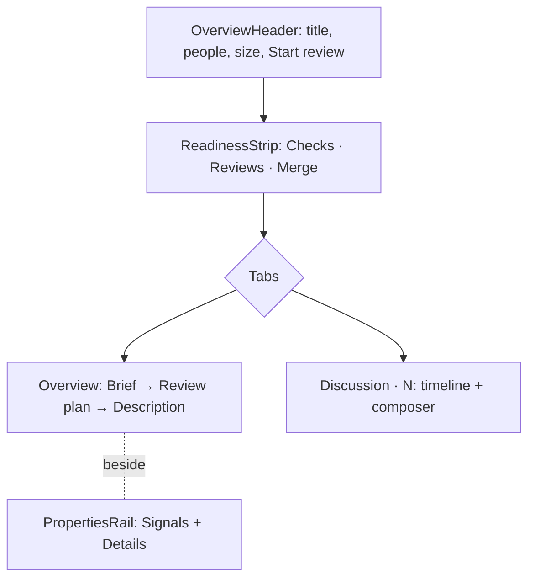
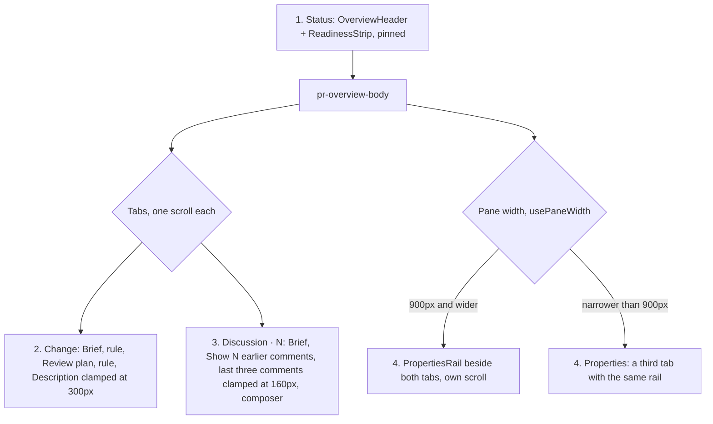

# ADR 112: The PR overview shows status before story

**Status**: Accepted, amended 2026-10-30
**Date**: 2026-10-14
**Relates to**: [ADR 072](072-a-review-reads-definitions-before-callers.md), [ADR 111](111-pr-summaries-run-the-review-agents-claude.md)

## Context

The PR overview gave every fact the same weight. A left column listed six uppercase labels in one muted colour, so "No conflicts" looked as urgent as "3 checks pending". The agent's summary and the author's description repeated each other in two framed panels, and the text ran edge to edge, about 200 characters per line. The numbers a reviewer decides on (size, risk, reading time, chapters) were on a third tab, Insights.

GitHub lists failing checks first in its merge box, GitLab is moving merge checks above the description, Graphite and Linear keep properties in a panel at the right, and Linear's guided reviews start from the core of the change.

## Decision

**The overview is ordered by the reviewer's decisions: can it merge, what is it, where do I start.**

- **Status is one strip under the header.** A settled state is muted, a waiting one is amber, and a blocker is red with its own action in its cell. Checks open grouped, failures first (`GroupedCheckList`).
- **Each fact appears once.** The Insights tab is gone. Its content is the rail's Signals, derived once in `overview-signals.ts`. Size and minutes are in the header.
- **The agent and the author are distinct.** The Brief is drawn in `--tm-agent` and limited to four points. When a Brief exists, the description below it is clamped, with **Show full description**.
- **Prose has a measure.** Description text stops at 68ch.
- **The review plan is the way in.** `pr.chapters` (ADR 072's order) is listed on the overview, and a row starts the review at that chapter through `setCurrentChapter`.

## Consequences

- No new data is fetched. Every value comes from `PrReviewDetail`.
- The Reviews cell is read-only: there is no request-reviewers call. Check durations are not shown, because `StatusCheckSchema` has no times.
- A running summary cannot be cancelled. No such channel exists (ADR 111).
- The Reviews cell cannot show "changes requested". `PrReviewDetail` carries `approvals` and `requestedReviewers` but not the review decision, which only the queue item has. Showing it in red needs the decision fetched with the detail.
- A second click on the Checks cell does not close its popover: the click outside closes it on mousedown, then the click reopens it. `ReviewHeader`'s popovers have the same problem. The fix belongs in `Popover` (`packages/extension-ui`), which should let a caller count the trigger as inside.
- The design and its renderings are in `docs/research/pr-overview-redesign.html`.

## Amended (2026-10-30): four sections

The overview read as one long scroll. The rail sat inside the Overview tab panel and scrolled away with the description, the Discussion tab had no rail, a narrow pane dropped the rail under the whole description, the description was unclamped until a Brief existed, and every comment showed in full.

**The overview is four fixed sections, and each scrolls on its own.**

- **Status** is the header and the readiness strip. The strip's accessible name is "Status"; it has no visible heading.
- **Change** replaces the Overview tab. A rule separates the Brief, the review plan and the description.
- **Discussion · N** shows the last three comments behind **Show N earlier comments**. Each comment body is clamped at 160px with **Show full comment**.
- **Properties** is the rail, outside the tabs, beside both. Below 900px the rail is not drawn beside the tabs; it is the **Properties** tab. CSS cannot add a tab, so `usePaneWidth` (a `ResizeObserver` on `.pr-overview-body`) gives React the width, and `pr-overview.css` switches the grid at the same width.
- **The description is always clamped**, with **Show full description**. A Brief no longer controls the clamp, and `summaryShown` is deleted.
- **Icons are flat.** Strip, rail and Brief icons take the text colour; a quiet or neutral state is drawn at 60% opacity. This replaces the coloured status icons above. The failing strip cell keeps its tinted background and red label, and the Brief is no longer drawn in `--tm-agent`.

The review plan is not clamped, so a PR with many chapters still makes the Change tab long. Summarize keeps its place and behaviour. The renderings are under "Amended" in `docs/research/pr-overview-redesign.html`.
