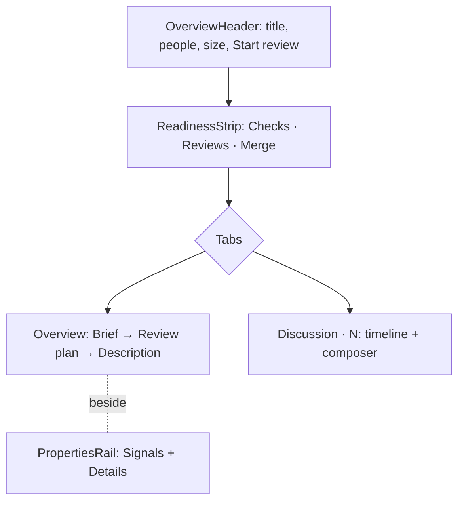

# ADR 112: The PR overview shows status before story

**Status**: Accepted
**Date**: 2026-10-14
**Relates to**: [ADR 072](072-a-review-reads-definitions-before-callers.md), [ADR 111](111-pr-summaries-run-the-review-agents-claude.md)

## Context

The PR overview gave every fact the same weight. A left column listed six uppercase labels in one muted colour, so "No conflicts" looked as urgent as "3 checks pending". The agent's summary and the author's description repeated each other in two framed panels, and the text ran edge to edge, about 200 characters per line. The numbers a reviewer decides on (size, risk, reading time, chapters) were on a third tab, Insights.

GitHub lists failing checks first in its merge box, GitLab is moving merge checks above the description, Graphite and Linear keep properties in a panel at the right, and Linear's guided reviews start from the core of the change.

## Decision

**The overview is ordered by the reviewer's decisions: can it merge, what is it, where do I start.**

- **Status is one strip under the header.** A settled state is muted, a waiting one is amber, and a blocker is red with its own action in its cell. Checks open grouped, failures first (`GroupedCheckList`).
- **Each fact appears once.** The Insights tab is gone. Its content is the rail's Signals, derived once in `overview-signals.ts`. Size and minutes are in the header.
- **The agent and the author are distinct.** The Brief is drawn in `--tm-agent` and limited to four points. When a Brief exists, the description below it is clamped, with **Show full description**.
- **Prose has a measure.** Description text stops at 68ch.
- **The review plan is the way in.** `pr.chapters` (ADR 072's order) is listed on the overview, and a row starts the review at that chapter through `setCurrentChapter`.

## Consequences

- No new data is fetched. Every value comes from `PrReviewDetail`.
- The Reviews cell is read-only: there is no request-reviewers call. Check durations are not shown, because `StatusCheckSchema` has no times.
- A running summary cannot be cancelled. No such channel exists (ADR 111).
- The design and its renderings are in `docs/research/pr-overview-redesign.html`.
