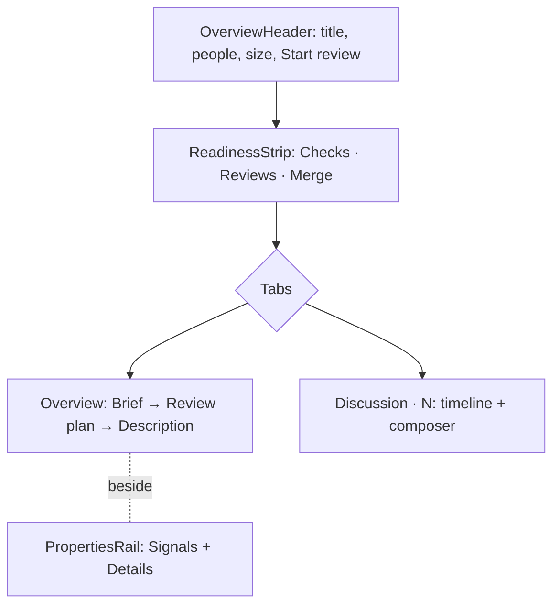
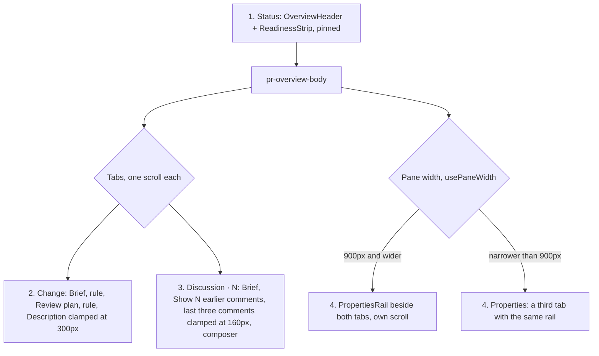

# ADR 112: The PR overview shows status before story

**Status**: Accepted, amended 2026-10-30
**Date**: 2026-10-14
**Relates to**: [ADR 072](072-a-review-reads-definitions-before-callers.md), [ADR 111](111-pr-summaries-run-the-review-agents-claude.md)

## Context

The PR overview gave every fact the same weight. A left column listed six uppercase labels in one muted colour, so "No conflicts" looked as urgent as "3 checks pending". Two framed panels repeated the summary of the agent and the description of the author. The text ran edge to edge, about 200 characters per line. The numbers that a reviewer decides on (size, risk, reading time, chapters) were on a third tab, Insights.

GitHub lists failing checks first in its merge box. GitLab is moving merge checks above the description. Graphite and Linear keep properties in a panel at the right. The guided reviews of Linear start from the core of the change.

## Decision

**The order of the overview follows the decisions of the reviewer: can it merge, what is it, where do I start.**

- **Status is one strip under the header.** A settled state is muted, a waiting state is amber, and a blocker is red with its own action in its cell. Checks open grouped, failures first (`GroupedCheckList`).
- **Each fact appears once.** The Insights tab is gone. Its content is the Signals of the rail, derived once in `overview-signals.ts`. Size and minutes are in the header.
- **The agent and the author are distinct.** The Brief is drawn in `--tm-agent` and limited to four points. When a Brief exists, the description below it is clamped, with **Show full description**.
- **Prose has a measure.** The description text stops at 68ch.
- **The review plan is the way in.** The overview lists `pr.chapters` (the order of ADR 072). A row starts the review at that chapter through `setCurrentChapter`.

## Consequences

- The overview fetches no new data. Every value comes from `PrReviewDetail`.
- The Reviews cell is read-only, because there is no request-reviewers call. The overview does not show check durations, because `StatusCheckSchema` has no times.
- You cannot cancel a running summary. No such channel exists (ADR 111).
- The Reviews cell cannot show "changes requested". `PrReviewDetail` carries `approvals` and `requestedReviewers` but not the review decision, which only the queue item has. To show the decision in red, the app must fetch it with the detail.
- A second click on the Checks cell does not close its popover. The click outside closes the popover on mousedown, and then the click reopens it. The popovers of `ReviewHeader` have the same problem. The fix belongs in `Popover` (`packages/extension-ui`), which should let a caller count the trigger as inside.
- The design and its renderings are in `docs/research/pr-overview-redesign.html`.

## Amended (2026-10-30): four sections

The overview read as one long scroll. The rail sat inside the Overview tab panel and scrolled away with the description. The Discussion tab had no rail. A narrow pane dropped the rail under the whole description. The description was unclamped until a Brief existed. Every comment showed in full.

**The overview is four fixed sections. Each section scrolls on its own.**

- **Status** is the header and the readiness strip. The accessible name of the strip is "Status". It has no visible heading.
- **Change** replaces the Overview tab. A rule separates the Brief, the review plan and the description.
- **Discussion · N** shows the last three comments. **Show N earlier comments** shows the rest. Each comment body is clamped at 160px with **Show full comment**.
- **Properties** is the rail, outside the tabs, beside both. Below 900px the app does not draw the rail beside the tabs. The rail is the **Properties** tab. CSS cannot add a tab. So `usePaneWidth` (a `ResizeObserver` on `.pr-overview-body`) gives React the width, and `pr-overview.css` switches the grid at the same width.
- **The description is always clamped**, with **Show full description**. A Brief no longer controls the clamp, and `summaryShown` is deleted.
- **Icons are flat.** Strip, rail and Brief icons take the text colour. A quiet or neutral state is drawn at 60% opacity. This replaces the coloured status icons above. The failing strip cell keeps its tinted background and red label. The Brief is no longer drawn in `--tm-agent`.

The review plan is not clamped, so a PR with many chapters still makes the Change tab long. Summarize keeps its place and behaviour. The renderings are under "Amended" in `docs/research/pr-overview-redesign.html`.
