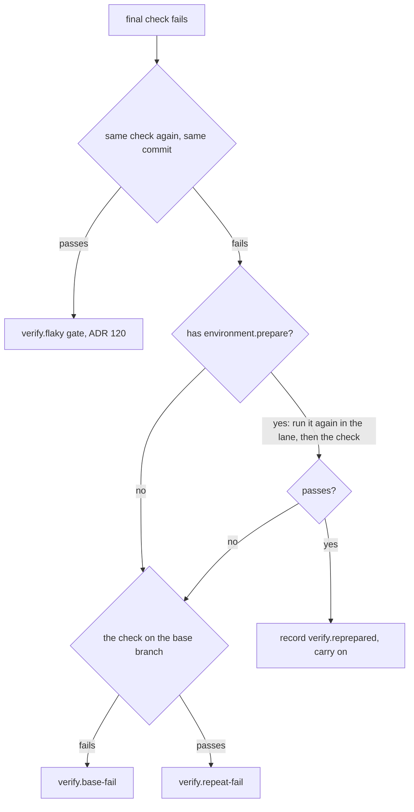

# ADR 122: Whose failure is it, by exit code

**Status**: Accepted

**Date**: 2026-10-21

Amended by ADR 123: question 1 (the same check again) is gone; the preparation again runs straight after the first failure.

Amends ADR 088 (Foundry mends installs and never opens orders).

## Context

ADR 088 decided that a failed check was a broken install. It read the log for
`Cannot find package` (Node) or `Library not loaded` (macOS). It then reinstalled
with a lockfile command (`npm ci`, `pnpm`, `yarn`). This worked for one toolchain.
The broken checkout of any other repository read as a code failure. A log that
happened to quote the phrase read as a broken install.

## Decision

**After a final-check failure, Foundry asks three questions in order. An exit code answers each one.**

1. **The same check again** on the same commit. If it passes, the result is `verify.flaky`
   (ADR 120, unchanged).
2. **The preparation again.** `environment.prepare` runs again in the lane
   (`reinstallDependencies`), then the check. If it passes, Foundry records `verify.reprepared`
   with both earlier logs: the checkout was broken, not the code. An order with
   no prepare command skips this question.
3. **The base branch** (`onBase`). If the check fails there, the result is `verify.base-fail`.
   If it passes, the result is `verify.repeat-fail`. A base that Foundry could not check stays "could not be
   checked", never a pass.

The base-branch proof (ADR 111, 121) uses the same rule. A step that failed
runs once more after `environment.prepare` ran again on the base checkout.
A step that then passes is recorded as `mended: true`.

No log is read to decide anything. `verify/broken-install.ts`,
`installCommandFor` and `verify.reinstalled` are gone.

## Consequences

- Foundry mends the broken checkout of any toolchain, because the repair is the
  own `prepare` command of the repository.
- A check that fails for a reason that a prepare cannot fix costs one extra
  preparation and one extra run before the base question.
- The gate no longer says that the installed dependencies are broken. A checkout that
  stays broken reads as an ordinary repeated failure.
