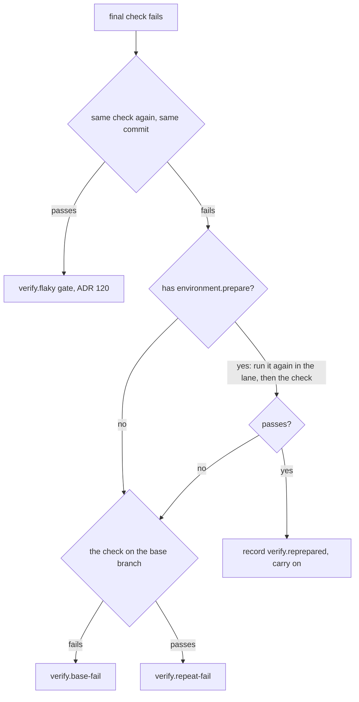

# ADR 122: Whose failure is it, by exit code

**Status**: Accepted

**Date**: 2026-10-21

Amended by ADR 123: question 1 (the same check again) is gone; the preparation again runs straight after the first failure.

Amends ADR 088 (Foundry mends installs and never opens orders).

## Context

ADR 088 decided a failed check was a broken install by reading its log for
Node's `Cannot find package` or macOS's `Library not loaded`, then reinstalled
with a lockfile command (`npm ci`, `pnpm`, `yarn`). It worked for one toolchain.
Any other repository's broken checkout read as a code failure, and a log that
happened to quote the phrase read as a broken install.

## Decision

**After a final-check failure, three questions are asked in order, and each is answered by an exit code.**

1. **The same check again** on the same commit. Passing is `verify.flaky`
   (ADR 120, unchanged).
2. **The preparation again.** `environment.prepare` runs again in the lane
   (`reinstallDependencies`), then the check. Passing records `verify.reprepared`
   with both earlier logs: the checkout was broken, not the code. An order with
   no prepare command skips this question.
3. **The base branch** (`onBase`). Failing there is `verify.base-fail`; passing
   is `verify.repeat-fail`. A base that could not be checked stays "could not be
   checked", never a pass.

The base-branch proof (ADR 111, 121) uses the same rule: a step that failed is
run once more after `environment.prepare` ran again on the base checkout, and
a step that then passes is recorded as `mended: true`.

No log is read to decide anything. `verify/broken-install.ts`,
`installCommandFor` and `verify.reinstalled` are gone.

## Consequences

- Any toolchain's broken checkout is mended, because the repair is the
  repository's own `prepare` command.
- A check that fails for a reason a prepare cannot fix costs one extra
  preparation and one extra run before the base question.
- The gate no longer says the installed dependencies are broken; a checkout that
  stays broken reads as an ordinary repeated failure.
